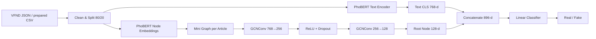
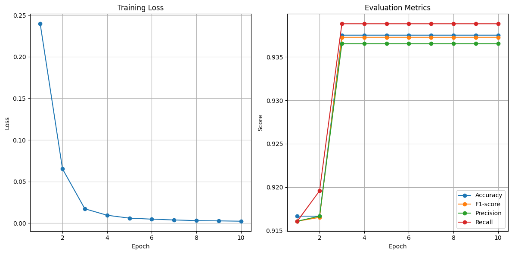

# Vietnamese Fake News Detection with PhoBERT and GCN

Academic research project for **Vietnamese fake-news detection** using a PhoBERT text encoder and Graph Convolutional Networks (GCN). The original report frames the system as a KAGN-inspired architecture combining text semantics, graph information, and attention.

> **Academic topic:** Applying graph convolutional neural networks and attention mechanism for fake news detection on social media in Vietnamese language  
> **Dataset:** Vietnamese Fake News Dataset (VFND)  
> **Frameworks:** PyTorch, PyTorch Geometric, Hugging Face Transformers

[Đọc README tiếng Việt](README.vi.md)

## Project Overview

The implementation starts from Vietnamese news/posts labeled as **Real (1)** or **Fake (0)**, encodes text and graph nodes with PhoBERT, propagates node representations through two `GCNConv` layers, concatenates the graph root representation with the document `[CLS]` representation, and predicts one of two classes.



## Dataset

The report uses **VFND – Vietnamese Fake News Dataset**, collected from 2017–2019 and organized around real/fake article/social content.

Dataset source documented in the report:

```text
https://github.com/WhySchools/VFND-vietnamese-fake-news-datasets
```

The uploaded notebook expects a prepared CSV with:

```text
text,label
```

where:

```text
Real = 1
Fake = 0
```

The notebook output shows:

```text
Train: 188
Test: 48
Total: 236
```

The dataset itself is not committed to this repository.

## Original Source Results

The uploaded notebook trained for **10 epochs** with:

- `Adam`
- learning rate `2e-5`
- `CrossEntropyLoss`
- mini-batch size `4`
- an 80/20 train-test split with `random_state=42`

From epoch 3 onward, the recorded metrics remain stable:

| Metric              | Notebook value |
| ------------------- | -------------: |
| Accuracy            |         0.9375 |
| Precision (macro)   |         0.9365 |
| Recall (macro)      |         0.9388 |
| F1-score (macro)    |         0.9373 |
| Final training loss |         0.0024 |



Exact values are stored in:

```text
results/report/history.csv
results/report/final_metrics.json
```

## Model

### Text branch

```text
Raw text
→ vinai/phobert-base
→ last_hidden_state[:, 0, :]
→ 768-d document representation
```

### Graph branch

Each article is represented as a small graph:

```text
Root node: full article/post text
Entity nodes: source notebook uses first 5 words as placeholders
Edges: root → entity nodes
Node encoding: PhoBERT [CLS]
```

GCN:

```text
768 → GCNConv → 256 → ReLU → Dropout(0.5)
    → GCNConv → 128
```

Fusion/classification:

```text
Text CLS 768 + Root graph embedding 128
                ↓
             896-d
                ↓
          Linear(896, 2)
                ↓
           Real / Fake
```

## Installation

Python 3.10+ is recommended.

```bash
python -m venv .venv
```

Windows:

```bash
.venv\Scripts\activate
```

Install:

```bash
pip install -r requirements.txt
```

## Prepare Data

If you already have `fnd_dataset.csv`:

```text
data/processed/fnd_dataset.csv
```

it must contain:

```text
text,label
```

To build a CSV from VFND JSON folders:

```bash
python scripts/build_dataset.py \
  --real-dir data/raw/real \
  --fake-article-dir data/raw/fake_articles \
  --fake-social-dir data/raw/fake_social \
  --output data/processed/fnd_dataset.csv
```

Folder names in VFND may differ; pass the actual local paths to the script.

## Train

Source-aligned settings:

```bash
python train.py \
  --data data/processed/fnd_dataset.csv \
  --epochs 10 \
  --batch-size 4 \
  --learning-rate 2e-5 \
  --entity-mode first_tokens
```

On Windows PowerShell, the same command can be written on one line:

```bash
python train.py --data data/processed/fnd_dataset.csv --epochs 10 --batch-size 4 --learning-rate 2e-5 --entity-mode first_tokens
```

To make graph edges bidirectional:

```bash
python train.py --data data/processed/fnd_dataset.csv --bidirectional-edges
```

That option is an improvement and is **not** the exact graph direction used in the original notebook.

## Evaluate

```bash
python evaluate.py \
  --data data/processed/fnd_dataset.csv \
  --checkpoint results/runs/default/best.pt
```
